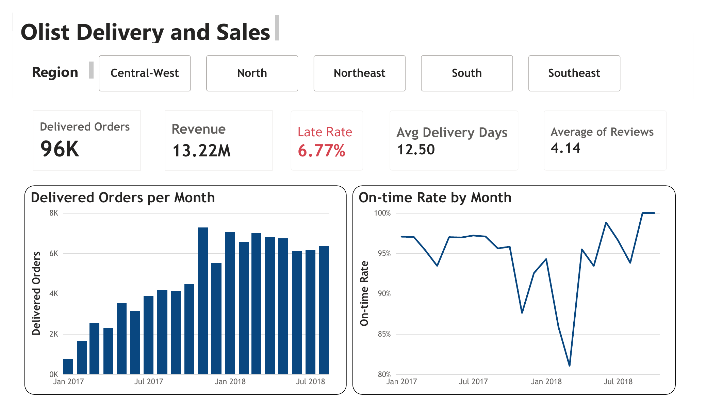
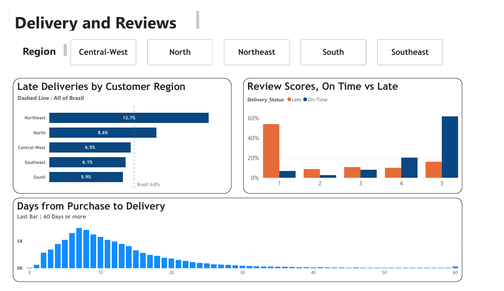
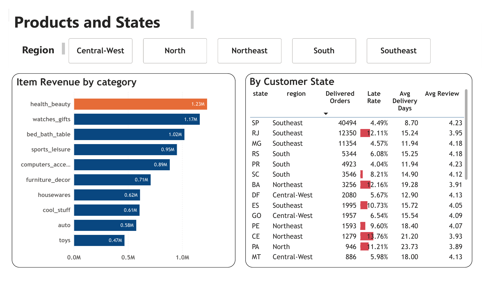

# Olist E-commerce Delivery Performance Analysis

How delivery delays affect customer satisfaction, and whether late deliveries can be predicted at purchase.
Final project for the **Data Analytics Diploma, Nile University**

## Business question
Do late deliveries hurt customer satisfaction, and can we predict a late delivery at the moment of purchase?

## Data
[Brazilian E-Commerce Public Dataset by Olist](https://www.kaggle.com/datasets/olistbr/brazilian-ecommerce) (Kaggle).
Real, anonymised orders from a Brazilian marketplace, 2016–2018. Seven linked tables (orders, items, customers, sellers, products, reviews, category translation) were combined into **one analytical table of 96,470 delivered orders and 25 columns**.

## Tools
- **Python:** pandas, matplotlib, seaborn, scikit-learn, XGBoost (Google Colab)
- **Power BI:** Power Query, DAX measures, star-schema data model

## Workflow
1. **Data understanding:** profiled each table for rows, columns, blank cells and duplicates
2. **Data cleaning:** kept delivered orders with a delivery date, converted dates, translated categories, handled missing values, one review score per order
3. **Feature engineering:** order-level totals, promised days, purchase month and weekday, customer region, same-state flag, and two targets: `delivery_days` and `late_flag`
4. **Exploratory analysis:** six business questions on distributions, monthly trends, categories, regions, reviews and correlations
5. **Machine learning:** regression (delivery days) and classification (late or on time) with scikit-learn pipelines, compared against baseline models, using only information available at purchase to avoid leakage
6. **Power BI dashboard:** four interactive pages with region slicers

## Key findings
| | |
|---|---|
| **Late rate** | **6.77%** of 96,470 delivered orders arrived after the promised date |
| **Reviews** | Late orders average **2.3 ⭐**, on-time orders **4.3 ⭐**. More than half of late orders get 1 star |
| **Regions** | Northeast **12.7%** late and North **8.6%**, vs South **5.9%** |
| **Promise vs reality** | Olist promises **24.4 days** on average but delivers in **12.5**; **78.9%** of orders arrive 7+ days early |
| **Route** | Same-state orders take **7.9 days** (4.5% late), vs **15.1 days** (8.0% late) across states |
| **Revenue** | **13.2M BRL**; health & beauty is the top category |
| **Prediction** | The classification model flags about **half of late orders** at purchase, with warnings **3.4×** more reliable than random |

## Dashboard
**1. Delivery and Sales:** KPIs, delivered orders and on-time rate by month

**2. Delivery and Reviews:** late rate by region, review scores for late vs on-time orders, delivery-time distribution

**3. Products and States:** top 10 categories by revenue, performance table by customer state

**4. Promise vs Reality:** promised vs actual delivery days by region and month, how early orders arrive, same-state vs other-state routes

## Recommendations
- Use the prediction model as an **early-warning tool**: send proactive updates for high-risk orders
- Focus logistics improvements on the **Northeast and North**
- Make delivery promises more **accurate by region**: they are much longer than reality, yet some orders are still late
- Encourage **local (same-state) sellers**, since their deliveries are faster and less often late

## Files
| File | Description |
|---|---|
| `Olist_Brazilian_E_commerce_Delivery_Analysis_.ipynb` | Python notebook: cleaning, EDA and machine learning |
| `Olist_Dashboard.pdf` | Power BI dashboard (4 pages) |
| `Olist_Final_Project_Presentation.pdf` | Final presentation |
| `Images/` | Dashboard screenshots |

## Author
**Mirna Y. Khalafallah**: [LinkedIn](https://www.linkedin.com/in/mirna-y-khalafallah-899021a9)
